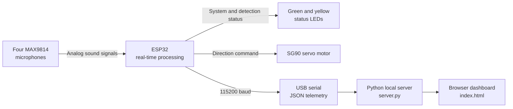

# Real-Time Acoustic Source Localization and Direction Tracking Using a Microcontroller-Based Microphone Array

## 1. Project Overview

This project is a real-time acoustic source localization system built using an ESP32 microcontroller, four analog microphones, and a servo motor.

The system:

- Captures sound activity from four microphones.
- Calibrates the background noise level of each microphone.
- Estimates the direction of an acoustic source over a 0°–180° front-facing field.
- Smooths the estimated direction to reduce sudden servo movements.
- Rotates an SG90 servo toward the detected sound source.
- Displays live direction, microphone levels, thresholds, signal strengths, and servo position on a browser dashboard.
- Provides microphone recalibration through a hardware push button.

The method used is **amplitude-based localization**. It compares the relative sound intensity received by the microphones. It does not use TDOA (Time Difference of Arrival).

---

## 2. System Architecture

The project has three main parts:



### Project files

```text
project-root/
├── code/
│   └── code.ino       ESP32 firmware
├── index.html         Browser dashboard
├── server.py          Local web server
└── README.md          Project documentation
```

---

## 3. Hardware Used

| Component | Quantity | Purpose |
|---|---:|---|
| ESP32-WROOM-32 | 1 | Microcontroller and ADC processing |
| MAX9814 microphone module | 4 | Analog sound-level input |
| SG90 servo motor | 1 | Physically points toward the estimated direction |
| Push button | 1 | Recalibration control |
| Green LED | 1 | System active indicator |
| Yellow LED | 1 | Sound detected indicator |
| Resistors, jumper wires, breadboard | As required | Circuit connections |
| USB cable | 1 | Programming and serial communication |

The ESP32 and all modules must share a common ground.

---

## 4. Pin Configuration

The pin assignments are defined at the beginning of `code/code.ino`.

| Device | ESP32 GPIO |
|---|---:|
| Microphone 1 | GPIO 32 |
| Microphone 2 | GPIO 33 |
| Microphone 3 | GPIO 34 |
| Microphone 4 | GPIO 35 |
| Servo signal | GPIO 18 |
| Push button | GPIO 27 |
| Green system LED | GPIO 25 |
| Yellow direction LED | GPIO 26 |

### Microphone direction mapping

| Microphone | Direction |
|---|---:|
| Mic 1 | 0° — left |
| Mic 2 | 60° |
| Mic 3 | 120° |
| Mic 4 | 180° — right |

The front direction is 90°.

### Button connection

The push button is connected between **GPIO 27 and GND**. The firmware uses:

```cpp
pinMode(BUTTON_PIN, INPUT_PULLUP);
```

Therefore, the button reads `LOW` when it is pressed.

---

## 5. Firmware: `code/code.ino`

The Arduino sketch contains the complete real-time sensing, processing, control, and telemetry logic.

### 5.1 Initialization

During `setup()` the firmware:

1. Starts serial communication at **115200 baud**.
2. Configures the ESP32 ADC with 12-bit resolution.
3. Configures the four microphone pins as analog inputs.
4. Sets 11 dB ADC attenuation for the microphone signals.
5. Configures the button using the internal pull-up resistor.
6. Configures the two status LEDs.
7. Attaches the servo using the `ESP32Servo` library.
8. Positions the servo initially at 90°.
9. Starts automatic microphone calibration.

### 5.2 Microphone activity measurement

The function `readSoundWindow()` measures the peak-to-peak variation of each microphone signal during a 20 ms window.

For every microphone:

```text
activity = maximum ADC reading - minimum ADC reading
```

A larger peak-to-peak value indicates stronger sound activity.

### 5.3 Automatic noise calibration

The function `calibrateNoise()` collects 150 sound windows over approximately 30 seconds.

For each microphone:

1. The 150 activity samples are sorted.
2. The median value is selected as the noise floor.
3. A detection threshold is calculated.

The threshold uses:

```text
margin = maximum of:
         minimum noise margin
         noise floor × (noise multiplier - 1)

threshold = maximum of:
            minimum threshold
            noise floor + margin
```

Current calibration constants:

| Setting | Value |
|---|---:|
| Calibration duration | 30 seconds |
| Number of windows | 150 |
| Window duration | 20 ms |
| Minimum threshold | 180 |
| Minimum noise margin | 100 |
| Noise multiplier | 1.35 |

Using the median reduces the effect of occasional loud sounds during calibration.

### 5.4 Normalized microphone strength

After calibration, each microphone's usable sound strength is calculated as:

```text
if activity <= threshold:
    strength = 0
else:
    strength = (activity - threshold) × microphone gain
```

The four microphone gains are currently initialized equally:

```cpp
float micGain[4] = {1.0, 1.0, 1.0, 1.0};
```

These values can be tuned later to compensate for differences between microphone modules.

### 5.5 Direction estimation

The function `estimateDirection()` determines the sound direction in several stages:

1. Calculate the normalized strength of all four microphones.
2. Find the microphone with the greatest strength.
3. Reject the reading if the strongest signal is below the minimum detection strength.
4. Check whether the strongest microphone is Mic 1 or Mic 4 and handle endpoint directions.
5. Consider only neighboring microphones.
6. Ignore a neighboring microphone if its strength is less than the configured minimum ratio.
7. Calculate a weighted average using the strongest microphone and valid neighbors.
8. Limit the result to the local region around the strongest microphone.

This local weighted approach prevents a distant microphone from pulling the result to an unrealistic direction.

Important detection settings:

| Setting | Value |
|---|---:|
| Minimum detection strength | 40 |
| Minimum neighboring strength ratio | 0.12 |
| Endpoint dominance ratio | 1.20 |
| Required consecutive detections | 2 |

Two consecutive valid detections are required before the system accepts a direction as confirmed.

### 5.6 Adaptive smoothing

The function `smoothAngle()` reduces jitter in the estimated direction.

- Normal direction changes use a smoothing factor of `0.35`.
- Large direction changes of 25° or more use a faster factor of `0.75`.

This allows the system to remain stable for small fluctuations while responding quickly when the sound source moves significantly.

### 5.7 Servo control

The servo direction is reversed to match the physical mounting arrangement:

```text
servo target = 180 - estimated sound angle
```

Servo limits:

| Setting | Value |
|---|---:|
| Minimum servo angle | 10° |
| Maximum servo angle | 170° |
| Minimum movement change | 3° |

The servo is moved only when the new target differs sufficiently from its current position.

### 5.8 Button controls

The button is debounced using a 50 ms debounce interval.

| Button action | System response |
|---|---|
| Short press | No action |
| Hold for 2 seconds | Start microphone recalibration |

### 5.9 LED indicators

| LED | Meaning |
|---|---|
| Green LED | System is active or calibrating |
| Yellow LED off | No sound direction currently detected |
| Yellow LED on | Sound direction detected |

---

## 6. Serial Telemetry

The ESP32 sends newline-separated JSON messages at **115200 baud**.

### Calibration messages

Examples:

```json
{"event":"calibration","progress":50}
```

```json
{
  "event":"calibration_values",
  "noiseFloor":[42,45,40,47],
  "thresholds":[180,180,180,180]
}
```

### Detection telemetry

The firmware sends values such as:

```json
{
  "event":"detected",
  "detected":true,
  "strongestMic":2,
  "angle":74.5,
  "smoothedAngle":76.1,
  "servoAngle":104,
  "mics":[310,480,260,90],
  "strength":[130.0,300.0,80.0,0.0],
  "noiseFloor":[42,45,40,47],
  "thresholds":[180,180,180,180]
}
```

The dashboard uses these values to update the radar, direction readout, servo position, microphone meters, thresholds, and calibration information.

Supported event types include:

- `system_ready`
- `calibration_started`
- `calibration`
- `calibration_values`
- `calibration_complete`
- `recalibration_started`
- `system_started`
- `button_pressed`
- `button_hold`
- `button_released`
- `button_long_press`
- `confirming`
- `detected`
- `no_sound`

---

## 7. Browser Dashboard: `index.html`

The dashboard is a single-page interface designed for live demonstration.

It displays:

- Project title and ESP32 connection status.
- A 0°–180° semicircular direction radar.
- Current estimated bearing.
- Strongest microphone.
- Servo position.
- Four microphone activity meters.
- Calibrated thresholds and noise floors.
- Normalized microphone signal strength.
- Calibration progress.
- Recalibration button feedback.

### Dashboard features

- **Connect device:** Opens the browser's Web Serial device selector.
- **Disconnect:** Closes the active serial connection.
- **Light/Dark mode:** Changes the dashboard theme and remembers the selection.
- **Live radar:** Draws the latest detected direction.
- **Responsive presentation layout:** The main desktop dashboard fits in one screen for demonstration.

The dashboard does not require a cloud service or a separate serial bridge. The browser communicates directly with the ESP32 using the Web Serial API.

### Browser requirement

Use a recent version of **Microsoft Edge or Google Chrome**. Web Serial is not supported in all browsers.

---

## 8. Local Web Server: `server.py`

The Python server exists to serve `index.html` from `localhost`.

It uses only Python's standard library:

```python
from http.server import SimpleHTTPRequestHandler, ThreadingHTTPServer
```

### Server behavior

- Binds to `127.0.0.1`.
- Uses port `8000`.
- Serves files from the project root directory.
- Uses `ThreadingHTTPServer` to handle browser requests.
- Adds a `Cache-Control: no-store` header so the browser receives the latest dashboard during development.
- Requires no external Python packages.

The dashboard should be opened through the server instead of directly from the file system because Web Serial requires a secure/allowed browser context such as `localhost`.

---

## 9. How to Run the Project

### Step 1: Install requirements

Install:

- Arduino IDE
- ESP32 board support for Arduino
- `ESP32Servo` library
- Python 3
- Microsoft Edge or Google Chrome

### Step 2: Upload the firmware

1. Open `code/code.ino` in Arduino IDE.
2. Select the ESP32 board.
3. Select the correct USB serial port.
4. Upload the sketch.
5. Wait for automatic calibration to complete.

### Step 3: Start the dashboard server

Open a terminal inside the project root folder and run:

```powershell
python server.py
```

The server starts at:

```text
http://localhost:8000
```

### Step 4: Connect the dashboard

1. Open `http://localhost:8000` in Edge or Chrome.
2. Close Arduino Serial Monitor if it is open.
3. Click **Connect device**.
4. Select the ESP32 serial port.
5. Allow serial access.
6. Keep normal background noise during calibration.
7. Generate a sound from different directions and observe the radar and servo.

Only one application should use the ESP32 serial port at a time.

---

## 10. Demonstration Procedure

For a classroom demonstration:

1. Power the ESP32 and allow the 30-second calibration to finish.
2. Keep the microphone array in a fixed physical arrangement.
3. Open the dashboard and connect to the ESP32.
4. Produce a sound near the left side and observe a direction near 0°.
5. Produce a sound in front and observe a direction near 90°.
6. Produce a sound near the right side and observe a direction near 180°.
7. Show that the servo moves toward the estimated source.
8. Press the button briefly to confirm that no action is taken.
9. Hold the button for two seconds to demonstrate recalibration.

---

## 11. GitHub Pages Deployment

The dashboard can be hosted using GitHub Pages instead of running `server.py`.
The repository includes a GitHub Actions workflow that publishes the root
`index.html` whenever changes are pushed to `main`.

To enable it:

1. Open the repository on GitHub.
2. Go to **Settings → Pages**.
3. Set the source to **GitHub Actions**.
4. Push to `main` or manually run the **Deploy SoundRadar to GitHub Pages** workflow.
5. Open the generated HTTPS Pages URL in Microsoft Edge or Google Chrome.

Connect the ESP32 to the same laptop that is running the browser. The hosted
page communicates directly with the USB serial device using the Web Serial API,
so `server.py` is not required when using GitHub Pages.

---

## 12. Design Choices and Advantages

- **Individual calibration:** Compensates for different microphone noise levels.
- **Median noise estimation:** Reduces the effect of occasional disturbances.
- **Normalized strength:** Makes microphone comparison more meaningful.
- **Local weighted estimation:** Produces smoother and more realistic directions.
- **Endpoint handling:** Improves accuracy near 0° and 180°.
- **Adaptive smoothing:** Balances stability and response speed.
- **Consecutive detection confirmation:** Reduces false servo movements.
- **Direct Web Serial communication:** Avoids a separate serial-to-web bridge.
- **Live visual feedback:** Makes the system easier to understand during demonstration.

---

## 13. Limitations and Future Improvements

### Current limitations

- The current method estimates direction from signal amplitude rather than arrival-time differences.
- Accuracy depends on microphone placement, microphone matching, and room acoustics.
- Reflections and echoes can affect the measured sound levels.
- The system estimates direction only in the 0°–180° front hemisphere.
- The microphone gain values are currently equal and may require physical calibration.
- The browser dashboard requires a compatible browser with Web Serial support.

### Possible future improvements

- Calibrate individual microphone gains automatically.
- Use TDOA or cross-correlation for improved localization.
- Add more microphones for finer angular resolution.
- Add a graphical confidence indicator.
- Store calibration values in non-volatile memory.
- Add wireless telemetry using Wi-Fi or Bluetooth.
- Apply digital filtering and frequency-based sound classification.

---

## 14. Summary

This project demonstrates a complete embedded acoustic direction-tracking system. The ESP32 performs real-time analog acquisition, calibration, signal processing, direction estimation, smoothing, and servo control. The Python server provides a local browser environment, while the dashboard presents the live system state in a clear visual form.

The result is an interactive microphone-array platform suitable for demonstrating embedded systems, signal processing, actuator control, and real-time human-machine interfaces.
